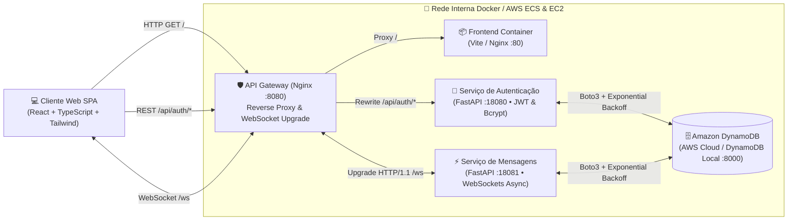
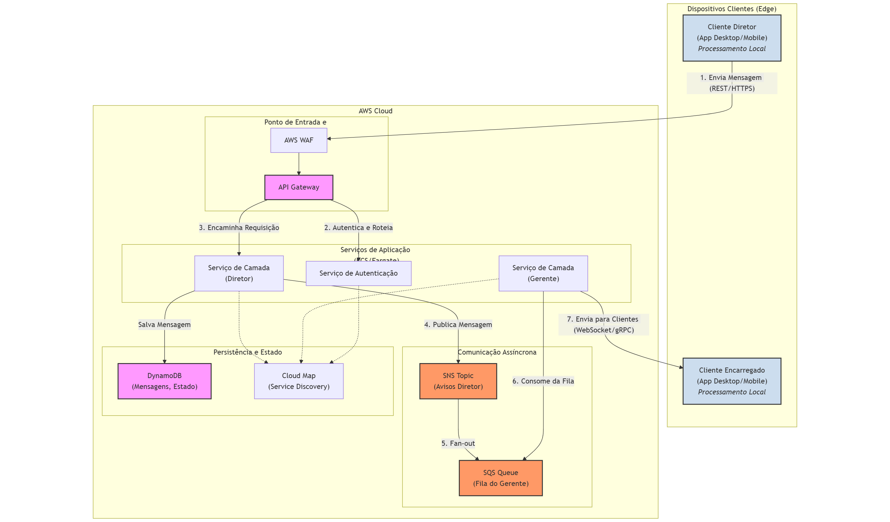

# 💬 Chat Corporativo Distribuído — Arquitetura de Microsserviços


Sistema de comunicação corporativa hierárquica em tempo real baseado em **Microsserviços**, desenvolvido para a disciplina de **Sistemas Distribuídos**. O projeto aplica na prática os conceitos de **transparência de localização e acesso**, **escalabilidade horizontal**, **concorrência assíncrona (ASGI/WebSockets)**, **coordenação distribuída com contadores atômicos** e **tolerância a falhas (*Exponential Backoff* e *Healthchecks*)**.

---

## 🏗️ Arquitetura do Sistema Distribuído

O cliente interage exclusivamente com o **API Gateway (Nginx)** na porta `8080`, que atua como *Reverse Proxy* ocultando a topologia interna da rede de contêineres e distribuindo o tráfego HTTP/REST e conexões persistentes WebSocket (`ws://`):





---

## 🧠 Pilares de Sistemas Distribuídos Implementados

1. **Transparência de Acesso e Localização (`api-gateway/nginx.conf`):**
   - O usuário acessa um único ponto de entrada (`:8080`). O Nginx roteia chamadas REST (`/api/auth/`) ao microsserviço de autenticação (`:18080`), realiza *protocol upgrade* em `/ws` para o microsserviço de mensagens (`:18081`) e serve a SPA React (`/`).
2. **Coordenação Distribuída e Atomicidade (`ChatContadores`):**
   - Utiliza operações atômicas de incremento no DynamoDB para gerar identificadores hierárquicos sequenciais por cargo (`dir-1`, `man-1`, `sup-1`, `emp-1`) livres de *race conditions* mesmo sob cadastros simultâneos.
3. **Concorrência Assíncrona Não-Bloqueante (`FastAPI / ASGI`):**
   - O `servico-mensagens` gerencia conexões WebSocket ativas em memória (`active_connections`) com `async/await`, realizando *broadcast* seletivo conforme a hierarquia corporativa (*Diretor*, *Gerente*, *Supervisor*, *Funcionário*).
4. **Tolerância a Falhas e Resiliência:**
   - **Exponential Backoff (`connect_with_retry`):** ambos os microsserviços aplicam retentativas com atraso exponencial ($2^n$ segundos até 32s) ao conectar ao DynamoDB.
   - **Healthchecks e Orquestração:** `docker-compose.yml` monitora `/health` nos microsserviços e gerencia dependências de inicialização (`service_healthy`).
5. **Segurança Stateless:**
   - Autenticação via **JWT (`HS256`)** e criptografia de senhas com **Bcrypt (`passlib`)**, permitindo escalar réplicas dos serviços sem afinidade de sessão (*sticky sessions*).

---

## 🗄️ Modelagem NoSQL no Amazon DynamoDB

O sistema provisiona e gerencia automaticamente **5 tabelas** no DynamoDB:

| Tabela | Partition Key (HASH) | Sort Key (RANGE) | Finalidade |
| :--- | :--- | :--- | :--- |
| **`ChatUsuarios`** | `email` (S) | — | Credenciais (hash Bcrypt), nome e papel hierárquico |
| **`ChatHierarquia`** | `id` (S) | — | Árvore organizacional (`role`, `manager_id`, subordinação) |
| **`ChatContadores`** | `role` (S) | — | Contadores atômicos distribuídos por nível hierárquico |
| **`ChatMensagens`** | `channelId` (S) | `timestamp` (S) | Histórico de mensagens ordenadas cronologicamente por canal |
| **`ChatReadReceipts`** | `userId` (S) | `channelId` (S) | Controle distribuído de última leitura por usuário e canal |

---

## 📂 Estrutura do Repositório

```text
chat-distribuido/
├── api-gateway/                         # Proxy Reverso Nginx
│   ├── Dockerfile
│   ├── nginx.conf                       # Configuração de produção
│   └── nginx.dev.conf                   # Configuração de desenvolvimento (hot-reload Vite)
├── backend/
│   ├── servico-autenticacao/            # Microsserviço REST de Autenticação e Hierarquia
│   │   ├── autenticacao_main.py         # FastAPI, JWT, Bcrypt, CRUD Usuários e Read Receipts
│   │   ├── requirements.txt
│   │   └── Dockerfile
│   └── servico-mensagens/               # Microsserviço WebSocket de Tempo Real
│       ├── mensagens_main.py            # FastAPI WebSockets, roteamento de canais e persistência
│       ├── requirements.txt
│       └── Dockerfile
├── frontend/                            # Single Page Application (React + TypeScript + Vite)
│   ├── src/
│   │   ├── components/                  # Interface do chat, canais, árvore hierárquica e login
│   │   ├── hooks/                       # Gerenciamento de estado e conexão WebSocket
│   │   ├── types/                       # Contratos TypeScript
│   │   └── App.tsx
│   ├── Dockerfile                       # Build multi-stage para produção (Nginx)
│   ├── Dockerfile.dev                   # Ambiente de desenvolvimento Vite
│   └── package.json
├── docs/                                # Documentação Técnica e Entregas Acadêmicas
│   ├── RELATORIO_FINAL.md               # Relatório técnico completo de Sistemas Distribuídos
│   ├── ENTREGA-1.md                     # Etapa 1: Definição da arquitetura
│   ├── ENTREGA-2.md                     # Etapa 2: Microsserviços e comunicação
│   ├── ENTREGA-3.md                     # Etapa 3: Persistência distribuída (DynamoDB)
│   ├── ENTREGA-4.md                     # Etapa 4: Implantação AWS ECR/EC2 e testes
│   └── Diagrama.png                     # Diagrama visual da arquitetura
├── docker-compose.dev.yml               # Orquestração local completa (com DynamoDB Local)
├── docker-compose.yml                   # Orquestração de produção (AWS ECR / EC2)
├── seed.py                              # Script de povoamento inicial de tabelas, usuários e mensagens
└── README.md                            # Documentação principal do projeto
```

---

## 🚀 Como Executar Localmente (Docker Compose + DynamoDB Local)

### Pré-requisitos
- **Docker** e **Docker Compose**
- **Python 3.8+** (opcional, para rodar o script `seed.py` de criação de usuários de demonstração)

### Passo a Passo

1. **Clone o repositório:**
   ```bash
   git clone https://github.com/RafaelJotta/chat-distribuido.git
   cd chat-distribuido
   ```

2. **Suba todos os microsserviços e o DynamoDB Local:**
   ```bash
   docker compose -f docker-compose.dev.yml up --build
   ```
   *(Ao iniciar em modo `IS_LOCAL=true`, os serviços criam automaticamente as 5 tabelas no `dynamodb-local`).*

3. **Popule o banco com usuários e mensagens iniciais (`seed.py`):**
   Em outro terminal, execute:
   ```bash
   pip install requests boto3
   python3 seed.py
   ```

4. **Acesse a aplicação no navegador:**
   - 👉 **Via API Gateway (Recomendado):** **`http://localhost:8080`**
   - 👉 **Frontend Vite Direto (Dev):** **`http://localhost:5173`**

---

## 🧪 Credenciais Geradas pelo `seed.py`

| Cargo (`role`) | Nome | E-mail | Senha | Nível de Acesso |
| :--- | :--- | :--- | :---: | :--- |
| **Diretor (`director`)** | Thiago Caproni | `adm@empresa.com` | `adm` | Visão global da hierarquia e acesso a todos os canais |
| **Gerente (`manager`)** | Alessandro Augusto | `alessandro@empresa.com` | `123` | Canais de gerência, equipe subordinada e canal geral |
| **Gerente (`manager`)** | Rafael Jotta | `rafael@empresa.com` | `123` | Canais de gerência, equipe subordinada e canal geral |
| **Gerente (`manager`)** | Amando Luiz | `amando@empresa.com` | `123` | Canais de gerência, equipe subordinada e canal geral |

---

## 🔌 Especificação Resumida das APIs

### 1. API REST — Serviço de Autenticação (`/api/auth`)
- `POST /api/auth/register` — Cadastra novo colaborador, incrementa contador atômico no DynamoDB e vincula à árvore hierárquica.
- `POST /api/auth/login` — Valida credenciais via Bcrypt e emite token **JWT**.
- `GET /api/auth/users/me` — Retorna dados do usuário autenticado via Bearer Token.
- `GET /api/auth/health` — *Healthcheck* do serviço de autenticação.

### 2. API WebSocket — Serviço de Mensagens (`ws://localhost:8080/ws`)
- **Handshake de Conexão (`user_connect`):** envia `{"type": "user_connect", "userId": "..."}` e recebe o evento `initialState` com a árvore hierárquica, canais permitidos, histórico de mensagens e recibos de leitura.
- **Envio de Mensagem (`message`):** persiste no DynamoDB (`ChatMensagens`) e transmite em tempo real para todos os clientes conectados com permissão no canal.
- **Confirmação de Leitura (`mark_channel_read`):** atualiza `ChatReadReceipts` no DynamoDB.

---

## 📚 Documentação Acadêmica Completa (`docs/`)

- 📘 **[Relatório Técnico Final — Sistemas Distribuídos (`RELATORIO_FINAL.md`)](./docs/RELATORIO_FINAL.md)**
- 📄 **[Entrega 1](./docs/ENTREGA-1.md)** • **[Entrega 2](./docs/ENTREGA-2.md)** • **[Entrega 3](./docs/ENTREGA-3.md)** • **[Entrega 4](./docs/ENTREGA-4.md)**

---

## 👨‍💻 Autores

- **Amando Luiz da Cruz** — [GitHub](https://github.com/AmandoLuizDaCruz)
- **Rafael Jotta** — [GitHub](https://github.com/RafaelJotta)
- **Alessandro Augusto**
